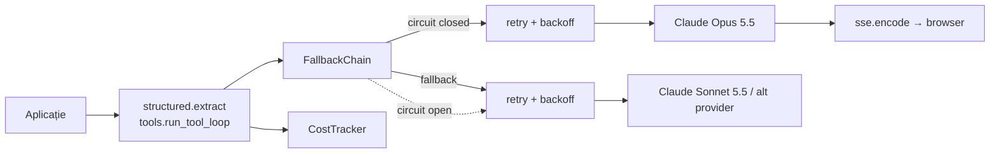

# 🧰 llm-reliability-kit

Pattern-urile de producție pentru apeluri către LLM-uri, scrise de mână, fără framework.
E codul care stă între „am un prompt care merge în playground” și „merge și când API-ul dă 529 la 3 noaptea”.

> Pasul 2 din planul meu de studiu (*AI Integration → AI Agent Engineer*): LLM APIs, tool calling,
> structured outputs, streaming, cost, retries și fallback.


## Ce conține

| Modul | Ce rezolvă | Detalii |
|---|---|---|
| `retry.py` | Erori tranzitorii (429, 5xx, timeout) | Exponential backoff cu *full jitter*, respectă `retry-after`, nu repetă niciodată un 400 |
| `fallback.py` | Un provider cade de tot | Lanț principal → rezerve + **circuit breaker** (closed → open → half-open), ca să nu pierdem timp pe un serviciu mort |
| `structured.py` | Modelul întoarce JSON greșit | Schemă strictă generată din Pydantic, validare și **reparare** cu eroarea exactă trimisă înapoi modelului |
| `tools.py` | Buclă `tool_use → tool_result` | Validare de argumente înainte de execuție, erorile devin `is_error`, apeluri paralele într-un singur mesaj, **aprobare umană** pentru acțiuni riscante, limită de pași |
| `cost.py` | „Cât ne costă o conversație?” | Prețuri per model, tokeni din cache (scriere ×1.25, citire ×0.1), tracker per conversație |
| `sse.py` | Streaming către browser | Codare și parsare SSE, eveniment `error` la mijlocul stream-ului, *time-to-first-token* |
| `providers/anthropic_provider.py` | Claude | `output_config.format` pentru JSON, `effort`, prompt caching pe system prompt, fallback pe server la refuz, clasificarea erorilor SDK |
| `providers/fake.py` | Teste fără rețea | Provider scriptat: răspunsuri, erori sau funcții care primesc cererea |

## Cifre: cât contează fiecare strat

Benchmark determinist (`python -m bench.reliability --md`): 2000 de cereri pe un ceas simulat.
Providerul principal are 20% erori tranzitorii și o pană totală de 10 minute; rezerva are 3% erori și e cu ~30% mai lentă.

| Configurație | Succes | Latență medie | p95 | Apeluri / cerere |
|---|---:|---:|---:|---:|
| fără retry | 50.4% | 0.75 s | 1.20 s | 1.00 |
| retry (4 încercări) | 91.0% | 1.49 s | 2.92 s | 1.50 |
| retry + fallback | 100.0% | 1.54 s | 3.83 s | 1.48 |
| retry + fallback + circuit breaker | 100.0% | 1.41 s | 1.98 s | 1.25 |

**Concluzii:**
- Retry-ul singur acoperă erorile scurte, dar nu și o pană: în cele 10 minute fiecare cerere își consumă toate cele 4 încercări și tot pică.
- Fallback-ul aduce succesul la 100%, dar **p95 crește** (3.83 s), pentru că fiecare cerere pierde întâi timp cu retry pe providerul căzut.
- Circuit breaker-ul oprește risipa: după 3 eșecuri la rând, principalul e sărit 60 s. p95 scade cu 48% și apelurile inutile cu 16%.

Un test (`tests/test_bench.py`) verifică aceste relații, ca o schimbare în retry sau fallback să nu le strice pe ascuns.

Prompt caching, calculat cu `cost.py`: un system prompt de 20k tokeni pe Sonnet 5.5, refolosit în 10 cereri, costă **sub 35%** din varianta fără cache (`test_caching_a_big_system_prompt_pays_off_after_two_calls`).

## Arhitectură



Toate modulele lucrează cu `LLMRequest` / `LLMResponse` (în `types.py`), nu cu tipurile unui SDK anume.
Un provider nou înseamnă o singură clasă cu `complete()` și `stream()`.

## Exemple

**Structured output cu reparare:**

```python
from pydantic import BaseModel, Field
from llmkit.structured import extract
from llmkit.providers.anthropic_provider import AnthropicProvider

class Lead(BaseModel):
    name: str
    budget_eur: int = Field(ge=0)
    urgency: str

out = extract(AnthropicProvider(), "Bună, sunt Ana, am 3000€ și îmi trebuie site-ul până vineri.", Lead)
print(out.value, out.repairs)
```

**Tool calling cu aprobare umană:**

```python
reg = ToolRegistry()

@reg.register("Rambursează o comandă", RefundArgs, needs_approval=True)
def refund(order_id: str, amount: float): ...

result = run_tool_loop(provider, "Vreau banii înapoi pe TN-1002", reg,
                       approver=lambda call: call.input["amount"] <= 500)
```

**Exemplu complet:** `python examples/claude_tool_loop.py`. Cu `ANTHROPIC_API_KEY` rulează pe Claude; fără cheie, pe providerul scriptat.

## Pornire

```bash
git clone https://github.com/cs1lyuha/llm-reliability-kit.git
cd llm-reliability-kit
python3 -m venv .venv && source .venv/bin/activate
pip install -r requirements.txt
pytest -q                          # 69 de teste, fără rețea
python -m bench.reliability        # benchmark-ul de mai sus
```

## Decizii și trade-off-uri

- **De ce retry-ul SDK-ului e oprit** (`max_retries=0`): ca retry, fallback și circuit breaker să fie un singur loc, cu aceeași politică pentru toți providerii. Altfel ar exista două straturi de retry, iar o cerere ar putea face 3 × 4 = 12 încercări.
- **De ce un 400 nu face fallback:** o cerere greșită pică la fel și la alt provider. Fallback-ul ar dubla costul și ar ascunde bug-ul.
- **De ce refuzul face fallback, dar nu deschide circuitul:** refuzul ține de conținutul cererii, nu de sănătatea providerului.
- **De ce validarea e și în Pydantic, nu doar în schema JSON:** schema garantează forma. Regulile de business (`quantity >= 1`, câmpuri nevide) trebuie verificate în cod.
- **Ordinea stabilă a uneltelor** (`ToolRegistry.specs` sortează după nume): orice schimbare de ordine invalidează prompt cache-ul.

## Ce urmează

- [ ] Rulare live pe Claude și cifre reale de latență / cost în tabel
- [ ] Al doilea provider real (OpenAI) în `FallbackChain`
- [ ] Endpoint FastAPI de demo cu streaming SSE
- [ ] Rate limiter pe client (token bucket)
